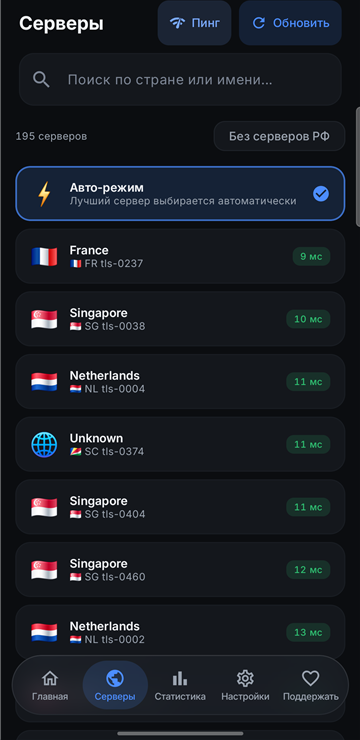
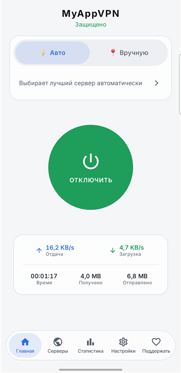

<h1 align="center">MyAppVPN</h1>

<div dir="rtl">

<p align="center"><b>کلاینت VPN بر پایه Xray / VLESS برای اندروید که خودش سرور سالم را پیدا می‌کند.</b></p>

<p align="center">
  <a href="README.md">English</a> · <a href="README.ru.md">Русский</a> · <b>فارسی</b> · <a href="README.zh-CN.md">简体中文</a> · <a href="README.tr.md">Türkçe</a> · <a href="README.kk.md">Қазақша</a> · <a href="README.uz.md">Oʻzbekcha</a>
</p>

<p align="center">
  <a href="https://github.com/indelingDanil/MyAppVPN/releases/latest"></a>
  <a href="https://github.com/indelingDanil/MyAppVPN/releases"></a>
  <a href="https://github.com/indelingDanil/MyAppVPN-CodeBase"></a>
  
  <a href="https://t.me/myappvpn_dprog"></a>
</p>

## این برنامه چیست

MyAppVPN یک کلاینت Xray / VLESS برای اندروید است. با یک لمس، برنامه خودش یک سرور سالم پیدا می‌کند، وصل می‌شود و اگر سرور فعلی مسدود شود، بدون قطع اتصال به سرور دیگری می‌رود. سرورها از فهرست‌های عمومی و از اشتراک اختصاصی پروژه، [MyAppVPN-subs](https://github.com/indelingDanil/MyAppVPN-subs)، می‌آیند که به‌طور خودکار به‌روز می‌شود. اگر سرورهای معمولی کار نکنند (مثلاً در اینترنت موبایلی که فقط «لیست سفید» را باز می‌گذارد)، حالت **OpenFlux** به شما اجازه می‌دهد خروجی خودتان را روی یک هاست وب معمولی راه بیندازید.

یک پروژه شخصی و متن‌باز: نه استارتاپ است، نه سرمایه‌گذار دارد و نه تله‌متری. تا امروز بیش از ۳۰٬۰۰۰ بار دانلود شده است.

رابط کاربری برنامه روسی است و اگر زبان سیستم گوشی انگلیسی باشد، انگلیسی نمایش داده می‌شود؛ به همین دلیل در ادامه نام گزینه‌ها به هر دو زبان آمده است.

## تصاویر

<p align="center">
  
  
  
  
  
</p>

## امکانات اصلی

- **حالت خودکار** — یک لمس: برنامه سرور سالم را پیدا می‌کند و وصل می‌شود.
- **متعادل‌کننده داخلی** — سرورها را با **دسترسی واقعی به تلگرام** می‌سنجد (نه فقط پینگ) و سریع‌ترین سرور سالم را نگه می‌دارد.
- **جابه‌جایی بی‌وقفه** — اگر سروری مسدود شود، ترافیک بدون اتصال دوباره از سرور دیگری عبور می‌کند.
- کلید **Auto / Manual** (Авто / Вручную) — می‌توانید خودتان سرور را انتخاب کنید؛ جابه‌جایی درجا انجام می‌شود.
- **فیلتر کشورها** — سرورهای روسیه به‌طور پیش‌فرض کنار گذاشته می‌شوند (تأخیر کم دارند، اما تلگرام و یوتیوب از آن‌جا باز نمی‌شوند)؛ قابل تنظیم است.
- فهرست سرورها در پس‌زمینه خودکار به‌روز می‌شود (zieng2/wl، igareck، MyAppVPN-subs).
- **تونل‌زنی تفکیکی (Split tunneling)** — برنامه‌هایی را که نباید از VPN رد شوند انتخاب کنید، یا حالت برعکس «Only selected via VPN / Только выбранные через VPN».
- **DNS دلخواه** — Cloudflare، Google، Quad9، AdGuard، Yandex یا سرور خودتان (DoH / معمولی)؛ درخواست‌ها از داخل تونل می‌روند.
- **دور زدن DPI (قطعه‌قطعه کردن TLS)** — یک گزینه اختیاری که به‌طور پیش‌فرض خاموش است.
- **OpenFlux (Beta)** — خروجی شخصی روی هاست وب معمولی، لینک‌های `openflux://` و ابزار عیب‌یابی اتصال.
- **اشتراک‌گذاری از طریق هات‌اسپات** — پروکسی HTTP و SOCKS5 با رمز عبور، همراه با راهنمای گام‌به‌گام.
- **Kill switch**، **Always-on VPN** و اتصال خودکار هنگام روشن شدن گوشی؛ اشتراک‌های خودتان را می‌توانید در Settings → Subscriptions (Настройки → Подписки) اضافه کنید.
- آمار لحظه‌ای ترافیک، طراحی «شیشه‌ای»، **تم روشن و تیره**.

## دانلود

👉 **[آخرین نسخه APK — Releases](https://github.com/indelingDanil/MyAppVPN/releases/latest)**

کدام فایل را دانلود کنم (اندروید ۸٫۰ یا جدیدتر):

| فایل | مناسب برای |
|---|---|
| `my-app-vpn-…-arm64.apk` | بیشتر گوشی‌ها، باکس‌ها و تلویزیون‌های Android TV |
| `my-app-vpn-…-arm32.apk` | اندروید ۳۲ بیتی: مدل‌های ارزان و قدیمی (مثلاً Samsung Galaxy A01 / A10 / A20 / A30، سری‌های J و M). اگر نسخه arm64 پیام «برنامه نصب نشد» داد، این را نصب کنید |

هنگام نصب، اجازه نصب از منابع ناشناس را بدهید — این کار برای هر APK خارج از Play Store عادی است. نسخه جدید روی نسخه قبلی نصب می‌شود و تنظیمات حفظ می‌شوند.

## شروع سریع

1. فایل APK را دانلود و نصب کنید.
2. برنامه را باز کنید و **CONNECT** (**ПОДКЛЮЧИТЬ**) را بزنید.
3. صبر کنید تا وضعیت از «Looking for a working server… / Поиск рабочего сервера…» به «Protected / Защищено» برسد. تمام.

برای انتخاب دستی سرور، از کلید **⚡ Auto | 📍 Manual** (Авто | Вручную) یا زبانه **Servers** (Серверы) استفاده کنید.

## OpenFlux

OpenFlux (Beta) برای شبکه‌هایی است که سرورهای معمولی VLESS در آن‌ها مسدود می‌شوند: برنامه ترافیک را از **خروجی شخصی شما روی یک هاست وب معمولی** عبور می‌دهد و نشست‌ها از قطعی‌های اتصال جان سالم به در می‌برند. با لینک `openflux://` هم می‌توانید به هر نود OpenFlux وصل شوید. راهنمای راه‌اندازی در شاخه [`openflux-exit`](https://github.com/indelingDanil/MyAppVPN/tree/openflux-exit) است.

## اشتراک اختصاصی: MyAppVPN-subs

[MyAppVPN-subs](https://github.com/indelingDanil/MyAppVPN-subs) یک ربات GitHub Actions است که اشتراک‌های عمومی VLESS را پیدا می‌کند، منابع حذف‌شده و رهاشده را کنار می‌گذارد، هر ۳ ساعت سرورها را جمع‌آوری و بررسی می‌کند، فقط سرورهای REALITY / TLS را نگه می‌دارد و فهرستی پاک‌سازی‌شده با پرچم کشور منتشر می‌کند. این اشتراک با نام «MyAppVPN (auto-collected)» در برنامه گنجانده شده است (در Settings → Subscriptions (Настройки → Подписки) می‌توانید خاموشش کنید). لینک برای کلاینت‌های دیگر (v2rayNG، Hiddify و …):

<div dir="ltr">

```
https://cdn.jsdelivr.net/gh/indelingDanil/MyAppVPN-subs@output/vless.txt
```

</div>

آینه‌ها، فهرست‌های جداگانه برای هر کشور و آمار در [README مخزن](https://github.com/indelingDanil/MyAppVPN-subs#readme) هستند.

## پرسش‌های متداول

**هنگام نصب پیام «برنامه نصب نشد» می‌آید.**
اندروید گوشی شما ۳۲ بیتی است — فایل `arm32` را دانلود کنید.

**وصل می‌شود، اما سایت‌ها باز نمی‌شوند.**
در حالت Manual (Вручную) سرور دیگری انتخاب کنید یا به Auto (Авто) برگردید. اگر فایده نداشت، گزینه **«DPI bypass (TLS fragmentation) / Обход DPI (фрагментация TLS)»** را در Settings → Connection (Настройки → Подключение) روشن کنید.

**اینترنت موبایل من فقط سایت‌های «لیست سفید» را باز می‌کند.**
در چنین شبکه‌هایی سرورهای معمولی اغلب کار نمی‌کنند. از OpenFlux با خروجی شخصی استفاده کنید؛ دکمه **«Connection diagnostics / Диагностика подключения»** در صفحه OpenFlux نشان می‌دهد کدام سرویس‌ها در دسترس‌اند و آیا شبکه شبیه حالت «لیست سفید» است یا نه.

**آیا امن است؟**
برنامه هیچ تله‌متری ندارد و کد آن متن‌باز است. اما سرورهای عمومی رایگان را افراد ناشناس اداره می‌کنند — هیچ اطلاعات ارزشمندی از طریق آن‌ها نفرستید.

**چطور برنامه بانکی را از VPN مستثنا کنم؟**
Settings → Choose apps (Настройки → Выбор приложений) → برنامه‌ها را تیک بزنید. یا حالت «Only selected via VPN / Только выбранные через VPN» را انتخاب کنید و فقط برنامه‌هایی را که باید از تونل بروند تیک بزنید.

**نسخه iOS هم وجود دارد؟**
هنوز نه. کمک‌های مالی صرف خرید یک Mac می‌شود — اگر جور شود، ساخت نسخه iOS را هم امتحان می‌کنم.

## حمایت از پروژه

قصد دارم برنامه را همچنان به‌روز کنم، اشکال‌هایش را رفع کنم و امکانات تازه اضافه کنم. اگر برنامه برایتان مفید بوده، کمک مالی شما ارزشمند است — برای خرید یک Mac پس‌انداز می‌کنم تا نسخه iOS را هم امتحان کنم. تا امروز بیش از ۳۰٬۰۰۰ دانلود — از همه شما ممنونم ❤️

👉 [کمک مالی از طریق CloudTips (روبل)](https://pay.cloudtips.ru/p/8c90d7a5)

👉 USDT (TRC20): `TB3Qn2guzVdj93kUi43KG8gQY6mruGZbNG`

👉 BTC (BTC): `16Bs15Mpu2HAYyVjgiLdwQC1yzLpbf2qyv`

👉 ETH (ERC20): `0x3704ecc83ea8b6a852d63dc82c0badcd761d8e6f`

راه‌های دیگر کمک: گزارش خطا → [#4](https://github.com/indelingDanil/MyAppVPN/issues/4)، ایده‌ها → [#5](https://github.com/indelingDanil/MyAppVPN/issues/5)، گفتگو → [#6](https://github.com/indelingDanil/MyAppVPN/issues/6)، یا فقط به مخزن ⭐ بدهید. اخبار نسخه‌های جدید: [کانال تلگرام](https://t.me/myappvpn_dprog).

## کد منبع

کد برنامه تحت مجوز **GPL-3.0** متن‌باز است: [indelingDanil/MyAppVPN-CodeBase](https://github.com/indelingDanil/MyAppVPN-CodeBase). تاریخچه نسخه‌ها: [CHANGELOG.md](CHANGELOG.md) (به انگلیسی).

## سلب مسئولیت

> ⚠️ این یک پروژه **آموزشی** است که برای اهداف آموزشی و پژوهشی ساخته شده است. نویسنده **هیچ مسئولیتی** در قبال نحوه استفاده شما از برنامه ندارد. در روسیه، سرویس‌های VPN برای دور زدن مسدودسازی‌ها طبق قانون محدود شده‌اند و ممکن است غیرقانونی تلقی شوند. استفاده با مسئولیت خودتان است.

## سپاسگزاری

- **[zieng2/wl](https://github.com/zieng2/wl)** — بدون این منبع سرور، این برنامه اصلاً وجود نداشت. یک نفر به‌تنهایی فهرست به‌روز سرورهای سالم VLESS را شبانه‌روزی، رایگان و برای همه نگه می‌دارد. قهرمانی بدون شنل.
- **[igareck/vpn-configs-for-russia](https://github.com/igareck/vpn-configs-for-russia)** — یک منبع سرور دیگر.
- **[p1neappleXpress/OpenFlux](https://github.com/p1neappleXpress/OpenFlux)** — هسته اصلی OpenFlux (GPL-3.0).
- **[XTLS/Xray-core](https://github.com/XTLS/Xray-core)** و **[xjasonlyu/tun2socks](https://github.com/xjasonlyu/tun2socks)** — موتور زیر کاپوت.
- **Claude (Anthropic)** — در تمام طول پروژه در توسعه کمک کرد 🤖 بله، از هوش مصنوعی استفاده می‌کنم. نه، «وایب‌کدر» نیستم — برنامه‌نویسی هستم که خیلی وقت‌ها با یک ربات مشورت می‌کند. مثل Stack Overflow، با این فرق که سؤال بعد از پنج سال بسته نمی‌شود. این تفاوت اساسی است، اصرار دارم.

</div>
