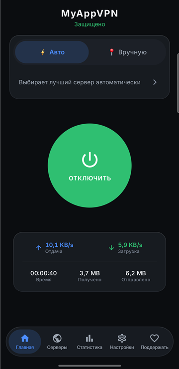
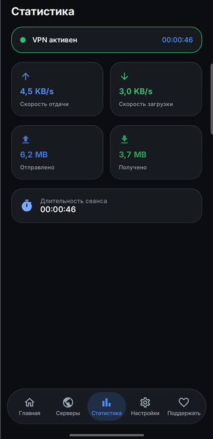

<h1 align="center">MyAppVPN</h1>

<p align="center"><b>Жұмыс істейтін серверді өзі табатын Android-қа арналған Xray / VLESS VPN-клиенті.</b></p>

<p align="center">
  <a href="README.md">English</a> · <a href="README.ru.md">Русский</a> · <a href="README.fa.md">فارسی</a> · <a href="README.zh-CN.md">简体中文</a> · <a href="README.tr.md">Türkçe</a> · <b>Қазақша</b> · <a href="README.uz.md">Oʻzbekcha</a>
</p>

<p align="center">
  <a href="https://github.com/indelingDanil/MyAppVPN/releases/latest"></a>
  <a href="https://github.com/indelingDanil/MyAppVPN/releases"></a>
  <a href="https://github.com/indelingDanil/MyAppVPN-CodeBase"></a>
  
  <a href="https://indelingdanil.github.io/MyAppVPN/"></a>
  <a href="https://t.me/myappvpn_dprog"></a>
</p>

## Бұл не

MyAppVPN — Android-қа арналған Xray / VLESS клиенті. Бір батырманы басасыз — қолданба жұмыс істейтін серверді өзі тауып, қосылады, ал қазіргі сервер бұғатталса, бірден басқасына ауысады. Серверлер ашық тізімдерден және жобаның автоматты түрде жаңартылатын өз жазылымынан — [MyAppVPN-subs](https://github.com/indelingDanil/MyAppVPN-subs) алынады. Кәдімгі серверлер өтпей қалғанда (мысалы, тек «ақ тізімдегі» сайттарды ашатын мобильді интернетте) **OpenFlux** режимі кәдімгі веб-хостингте өз шығысыңызды іске қосуға мүмкіндік береді.

Ашық кодты жеке жоба: стартап емес, инвесторлар жоқ, телеметрия жоқ. Қазірдің өзінде 30 000-нан астам рет жүктелген.

Қолданба интерфейсі орыс тілінде (телефонның жүйелік тілі ағылшынша болса — ағылшынша), сондықтан төменде мәзір атаулары орысша берілген.

## Скриншоттар

<p align="center">
  
  
  
  
  
</p>

## Негізгі мүмкіндіктер

- **Авто-режим** — бір басу: қолданба жұмыс істейтін серверді өзі тауып, қосылады.
- **Кіріктірілген теңгерімдеуші** — серверлерді жай пингпен емес, **Telegram-ның нақты қолжетімділігі** бойынша тексеріп, ең жылдам жұмыс істейтінін ұстап тұрады.
- **Үзіліссіз ауысу** — сервер бұғатталса, трафик қайта қосылмай-ақ басқа сервер арқылы өте береді.
- **Авто / Вручную** ауыстырғышы — серверді өзіңіз таңдай аласыз, ауысу бірден жүреді.
- **Елдер сүзгісі** — Ресей серверлері әдепкі бойынша алынып тасталған (кідірісі аз, бірақ ол жерден Telegram/YouTube ашылмайды); баптауға болады.
- Серверлер тізімі фондық режимде өздігінен жаңарып отырады (zieng2/wl, igareck, MyAppVPN-subs).
- **Бөлек туннельдеу (split tunneling)** — VPN-ді айналып өтетін қолданбаларды таңдаңыз немесе кері режимді — «Только выбранные через VPN» қолданыңыз.
- **Өз DNS-іңіз** — Cloudflare, Google, Quad9, AdGuard, Яндекс немесе өз серверіңіз (DoH / қарапайым), сұраулар туннель арқылы жүреді.
- **DPI-ді айналып өту (TLS фрагментациясы)** — қосымша баптау, әдепкі бойынша өшірулі.
- **OpenFlux (Beta)** — кәдімгі веб-хостингтегі өз шығысыңыз, `openflux://` сілтемелері және қосылым диагностикасы.
- **Хотспот арқылы тарату** — HTTP-прокси және құпиясөзі бар SOCKS5, қадамдық нұсқаулығымен.
- **Kill switch**, **Always-on VPN** және телефон іске қосылғанда автоматты қосылу; өз жазылымдарыңызды Настройки → Подписки бөлімінде қоса аласыз.
- Нақты уақыттағы трафик статистикасы, «шыны» дизайн, **ашық және қараңғы тақырыптар**.

## Жүктеп алу

👉 **[Соңғы APK — Releases](https://github.com/indelingDanil/MyAppVPN/releases/latest)**

Қай файлды жүктеу керек (Android 8.0 немесе жаңарақ):

| Файл | Кімге |
|---|---|
| `my-app-vpn-…-arm64.apk` | Көптеген телефондар, Android TV приставкалары мен теледидарлар |
| `my-app-vpn-…-arm32.apk` | 32-биттік Android: арзан және ескі модельдер (мысалы, Samsung Galaxy A01 / A10 / A20 / A30, J және M сериялары). arm64 «Қолданба орнатылмады» деп шықса, осыны орнатыңыз |

Орнату кезінде белгісіз көздерден орнатуға рұқсат беріңіз — Play Store-дан тыс кез келген APK үшін бұл қалыпты қадам. Жаңа нұсқа ескісінің үстіне орнатылады, баптаулар сақталады.

## Жылдам бастау

1. APK-ны жүктеп алып, орнатыңыз.
2. Қолданбаны ашып, **ПОДКЛЮЧИТЬ** батырмасын басыңыз.
3. Күй «Поиск рабочего сервера…» → «Защищено» болғанын күтіңіз. Дайын.

Серверді өзіңіз таңдау үшін басты экрандағы **⚡ Авто | 📍 Вручную** ауыстырғышын немесе **Серверы** қойындысын пайдаланыңыз.

## OpenFlux

OpenFlux (Beta) кәдімгі VLESS-серверлер бұғатталатын желілерге арналған: қолданба трафикті **кәдімгі веб-хостингтегі өз шығысыңыз** арқылы өткізеді, ал сессиялар байланыс үзілсе де сақталады. Кез келген OpenFlux түйініне `openflux://` сілтемесі арқылы да қосылуға болады. Баптау нұсқаулығы — [`openflux-exit`](https://github.com/indelingDanil/MyAppVPN/tree/openflux-exit) тармағында.

## Өз жазылымымыз: MyAppVPN-subs

[MyAppVPN-subs](https://github.com/indelingDanil/MyAppVPN-subs) — GitHub Actions боты: ашық VLESS-жазылымдарды өзі табады, жойылған және ескірген көздерді алып тастайды, әр 3 сағат сайын серверлерді жинап, тексереді, тек REALITY / TLS серверлерін қалдырып, ел жалаушалары бар тазартылған тізімді жариялайды. Қолданбаға ол «MyAppVPN (авто-сбор)» деген атпен кіріктірілген (Настройки → Подписки бөлімінде өшіруге болады). Басқа клиенттерге (v2rayNG, Hiddify т.б.) арналған сілтеме:

```
https://cdn.jsdelivr.net/gh/indelingDanil/MyAppVPN-subs@output/vless.txt
```

Айналар, елдер бойынша тізімдер және статистика — [репозиторийдің README файлында](https://github.com/indelingDanil/MyAppVPN-subs#readme).

## Жиі қойылатын сұрақтар

**Орнатқанда «Қолданба орнатылмады» деп шығады.**
Телефоныңызда 32-биттік Android — `arm32` APK файлын жүктеп алыңыз.

**Қосылады, бірақ сайттар ашылмайды.**
«Вручную» режимінде басқа серверді таңдаңыз немесе «Авто»-ға қайтыңыз. Көмектеспесе, Настройки → Подключение бөлімінде **«Обход DPI (фрагментация TLS)»** баптауын қосыңыз.

**Мобильді интернетім тек «ақ тізімдегі» сайттарды ашады.**
Мұндай желілерде кәдімгі серверлер көбіне жұмыс істемейді. Өз шығысыңызбен OpenFlux-ты пайдаланыңыз; OpenFlux экранындағы **«Диагностика подключения»** батырмасы қай сервистер қолжетімді екенін және желі «ақ тізім» режиміне ұқсай ма, соны көрсетеді.

**Бұл қауіпсіз бе?**
Қолданбада телеметрия жоқ, коды ашық. Бірақ тегін ашық серверлерді белгісіз адамдар ұстайды — олар арқылы құнды ештеңе жібермеңіз.

**Банк қолданбасы VPN-ді айналып өтуі үшін не істеу керек?**
Настройки → Выбор приложений → қажеттілерін белгілеңіз. Немесе «Только выбранные через VPN» режимін қосып, туннель арқылы жүруі керек қолданбаларды ғана белгілеңіз.

**iOS нұсқасы бар ма?**
Әзірге жоқ. Донаттар Mac сатып алуға жиналуда — Mac болса, iOS нұсқасын да жасап көремін.

## Жобаны қолдау

Қолданбаны әрі қарай жаңартып, түзетіп, жетілдіре беруді жоспарлап отырмын. Егер ол пайдалы болса, донат үлкен көмек — iOS нұсқасын да жасап көру үшін Mac-қа жинап жүрмін. Қазірдің өзінде 30 000-нан астам жүктеу — барлығыңызға рахмет ❤️

👉 [CloudTips арқылы донат (RUB)](https://pay.cloudtips.ru/p/8c90d7a5)

👉 USDT (TRC20): `TB3Qn2guzVdj93kUi43KG8gQY6mruGZbNG`

👉 BTC (BTC): `16Bs15Mpu2HAYyVjgiLdwQC1yzLpbf2qyv`

👉 ETH (ERC20): `0x3704ecc83ea8b6a852d63dc82c0badcd761d8e6f`

Басқаша да көмектесуге болады: қате туралы хабарлама → [#4](https://github.com/indelingDanil/MyAppVPN/issues/4), идеялар → [#5](https://github.com/indelingDanil/MyAppVPN/issues/5), әңгімелесу → [#6](https://github.com/indelingDanil/MyAppVPN/issues/6), немесе репозиторийге ⭐ қойыңыз. Жаңа нұсқалар туралы жаңалықтар — [Telegram арнасында](https://t.me/myappvpn_dprog).

## Бастапқы код

Қолданба коды **GPL-3.0** лицензиясымен ашық: [indelingDanil/MyAppVPN-CodeBase](https://github.com/indelingDanil/MyAppVPN-CodeBase). Нұсқалар тарихы: [CHANGELOG.md](CHANGELOG.md) (ағылшынша).

## Жауапкершіліктен бас тарту

> ⚠️ Бұл — білім беру және зерттеу мақсатында жасалған **оқу** жобасы. Автор қолданбаны қалай пайдаланатыныңызға **жауап бермейді**. Ресейде бұғаттауларды айналып өтуге арналған VPN-сервистер заңмен шектелген және заңсыз деп танылуы мүмкін. Барлық тәуекел өзіңізде.

## Алғыс

- **[zieng2/wl](https://github.com/zieng2/wl)** — бұл серверлер көзі болмаса, қолданба мүлде болмас еді. Бір адам жұмыс істейтін VLESS-серверлердің өзекті тізімін тәулік бойы, тегін, барлығы үшін жүргізіп отыр. Плащсыз батыр.
- **[igareck/vpn-configs-for-russia](https://github.com/igareck/vpn-configs-for-russia)** — тағы бір серверлер көзі.
- **[p1neappleXpress/OpenFlux](https://github.com/p1neappleXpress/OpenFlux)** — OpenFlux-тың бастапқы ядросы (GPL-3.0).
- **[XTLS/Xray-core](https://github.com/XTLS/Xray-core)** және **[xjasonlyu/tun2socks](https://github.com/xjasonlyu/tun2socks)** — капот астындағы қозғалтқыш.
- **Claude (Anthropic)** — жоба бойы әзірлеуге көмектесті 🤖 Иә, әзірлеуде жасанды интеллектті қолданамын. Жоқ, мен «вайбкодер» емеспін — роботпен жиі ақылдасатын бағдарламашымын. Stack Overflow сияқты, тек сұрақ бес жылдан кейін жабылып қалмайды. Айырмашылық түбегейлі, мен соған табандымын.
