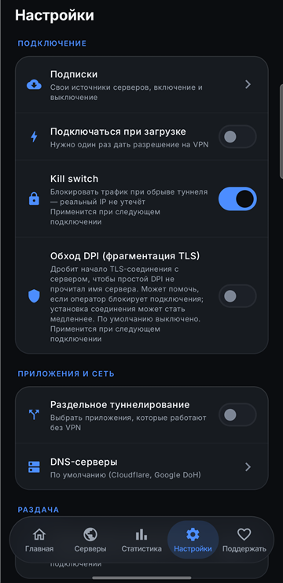

<h1 align="center">MyAppVPN</h1>

<p align="center"><b>Xray / VLESS VPN client for Android that finds a working server by itself.</b></p>

<p align="center">
  <b>English</b> · <a href="README.ru.md">Русский</a> · <a href="README.fa.md">فارسی</a> · <a href="README.zh-CN.md">简体中文</a> · <a href="README.tr.md">Türkçe</a> · <a href="README.kk.md">Қазақша</a> · <a href="README.uz.md">Oʻzbekcha</a>
</p>

<p align="center">
  <a href="https://github.com/indelingDanil/MyAppVPN/releases/latest"></a>
  <a href="https://github.com/indelingDanil/MyAppVPN/releases"></a>
  <a href="https://github.com/indelingDanil/MyAppVPN-CodeBase"></a>
  
  <a href="https://indelingdanil.github.io/MyAppVPN/"></a>
  <a href="https://t.me/myappvpn_dprog"></a>
</p>

## What it is

MyAppVPN is an Xray / VLESS client for Android. Tap one button and it finds a working server, connects, and switches to another one on the fly if the current server gets blocked. Servers come from public lists plus the project's own auto-updated subscription, [MyAppVPN-subs](https://github.com/indelingDanil/MyAppVPN-subs). When regular servers don't get through (for example, on whitelist-only mobile networks), the **OpenFlux** mode lets you run your own exit on ordinary web hosting.

A personal open-source project: not a startup, no investors, no telemetry. 30,000+ downloads so far.

## Screenshots

<p align="center">
  
  
  
  
  
</p>

## Key features

- **Auto mode** — one tap: the app finds a working server and connects.
- **Built-in balancer** — checks servers against **real Telegram availability** (not just ping) and keeps the fastest working one.
- **Seamless failover** — if a server gets blocked, traffic moves to another one without reconnecting.
- **Auto / Manual** switch — pick a server yourself; switching happens live.
- **Country filter** — Russian servers are excluded by default (low latency, but no Telegram/YouTube from there); configurable.
- Server list updates automatically in the background (zieng2/wl, igareck, MyAppVPN-subs).
- **Split tunneling** — choose apps that bypass the VPN, or use the inverse "Only selected via VPN" mode.
- **Custom DNS** — Cloudflare, Google, Quad9, AdGuard, Yandex or your own (DoH / plain); queries go through the tunnel.
- **DPI bypass (TLS fragmentation)** — optional setting, off by default.
- **OpenFlux (Beta)** — your own exit on ordinary web hosting, `openflux://` links, connection diagnostics.
- **Hotspot sharing** — HTTP proxy and password-protected SOCKS5, with a step-by-step guide.
- **Kill switch**, **Always-on VPN** and auto-connect on boot; add your own subscriptions in Settings → Subscriptions.
- Real-time traffic stats, glass-style design, **light and dark themes**, Russian and English UI (follows the system language).

## Download

👉 **[Latest APK — Releases](https://github.com/indelingDanil/MyAppVPN/releases/latest)**

Which file (Android 8.0 or newer):

| File | For |
|---|---|
| `my-app-vpn-…-arm64.apk` | Most phones, Android TV boxes and TVs |
| `my-app-vpn-…-arm32.apk` | 32-bit Android: budget and older models (e.g. Samsung Galaxy A01 / A10 / A20 / A30, J and M series). Use it if arm64 says "App not installed" |

When installing, allow installation from unknown sources — this is standard for any APK outside the Play Store. Updates install over the previous version and keep your settings.

## Quick start

1. Download and install the APK.
2. Open the app and tap **CONNECT**.
3. Wait for "Looking for a working server…" → "Protected". Done.

To choose a server yourself, use the **⚡ Auto | 📍 Manual** switch or the **Servers** tab.

## OpenFlux

OpenFlux (Beta) is for networks where regular VLESS servers are blocked: the app tunnels traffic through **your own exit on ordinary web hosting**, and sessions survive connection drops. You can also connect to any OpenFlux node with an `openflux://` link. Setup guide: the [`openflux-exit`](https://github.com/indelingDanil/MyAppVPN/tree/openflux-exit) branch.

## Own subscription: MyAppVPN-subs

[MyAppVPN-subs](https://github.com/indelingDanil/MyAppVPN-subs) is a GitHub Actions bot that finds public VLESS subscriptions, drops deleted and stale sources, collects and checks servers every 3 hours, keeps only REALITY / TLS ones and publishes a cleaned list with country flags. It's built into the app as "MyAppVPN (авто-сбор)" (auto-collected; can be turned off in Settings → Subscriptions). Link for other clients (v2rayNG, Hiddify, etc.):

```
https://cdn.jsdelivr.net/gh/indelingDanil/MyAppVPN-subs@output/vless.txt
```

Mirrors, per-country lists and stats are in the [repo README](https://github.com/indelingDanil/MyAppVPN-subs#readme).

## FAQ

**"App not installed" when installing.**
Your phone runs 32-bit Android — download the `arm32` APK.

**It connects, but sites don't load.**
Pick another server in Manual mode or go back to Auto. If that doesn't help, turn on **"DPI bypass (TLS fragmentation)"** in Settings → Connection.

**My mobile network only lets "whitelisted" sites through.**
Regular servers often don't work on such networks. Use OpenFlux with your own exit; the **Connection diagnostics** button on the OpenFlux screen shows which services are reachable and whether the network looks whitelist-only.

**Is it safe?**
The app has no telemetry and its source code is open. But free public servers are run by unknown people — don't send anything valuable through them.

**How do I let my banking app bypass the VPN?**
Settings → Choose apps → tick the apps. Or switch to "Only selected via VPN" and tick the ones that should use the tunnel.

**Is there an iOS version?**
Not yet. Donations go towards a Mac — with one, I'll try to build an iOS version too.

## Support the project

I plan to keep updating, fixing and improving the app. If it's been useful, a donation helps — I'm saving up for a Mac to try building an iOS version as well. 30,000+ downloads so far — thank you all ❤️

👉 [Donate via CloudTips (RUB)](https://pay.cloudtips.ru/p/8c90d7a5)

👉 Donate USDT (TON): `UQBi78BaJNXuEXHrP-OhuFAIf29yvpIo1s2agHiTQPB-xWbE`

👉 Donate USDT (TRC20): `TYaGhM39zKXS3g177R6VvBhNLkbsFgYAHj`

👉 Donate BTC (BTC): `bc1qjrtd68le7dcd2h2psqcgmp4nvcp9p092m7ew8z`

👉 Donate USDT (BEP20): `0xB65bb82aB8f85db12b3DEfebE2a4a0b210f097d6`

Other ways to help: bug reports → [#4](https://github.com/indelingDanil/MyAppVPN/issues/4), ideas → [#5](https://github.com/indelingDanil/MyAppVPN/issues/5), chat → [#6](https://github.com/indelingDanil/MyAppVPN/issues/6), or just star the repo ⭐. Release news: [Telegram channel](https://t.me/myappvpn_dprog).

## Source code

The app is open source under **GPL-3.0**: [indelingDanil/MyAppVPN-CodeBase](https://github.com/indelingDanil/MyAppVPN-CodeBase). Version history: [CHANGELOG.md](CHANGELOG.md).

## Disclaimer

> ⚠️ This is an **educational** project, made for learning and research purposes. The author **is not responsible** for how you use the app. In Russia, VPN services for bypassing blocks are restricted by law and may be considered illegal. Use at your own risk.

## Acknowledgements

- **[zieng2/wl](https://github.com/zieng2/wl)** — without this server source the app simply wouldn't exist. One person keeps an up-to-date list of working VLESS servers 24/7, for free, for everyone. A hero without a cape.
- **[igareck/vpn-configs-for-russia](https://github.com/igareck/vpn-configs-for-russia)** — another server source.
- **[p1neappleXpress/OpenFlux](https://github.com/p1neappleXpress/OpenFlux)** — the upstream OpenFlux core (GPL-3.0).
- **[XTLS/Xray-core](https://github.com/XTLS/Xray-core)** and **[xjasonlyu/tun2socks](https://github.com/xjasonlyu/tun2socks)** — the engine under the hood.
- **Claude (Anthropic)** — helped with development throughout the project 🤖 Yes, I use AI. No, I'm not a vibe coder — I'm a programmer who consults a robot very often. It's like Stack Overflow, except the question tab doesn't get closed five years later. The difference is fundamental, I insist.
